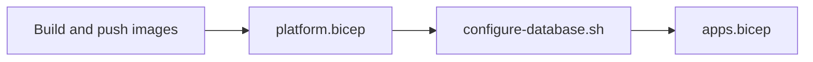

# GISR deployment

GISR deploys to Azure Container Apps in `rg-apps`, reusing the shared registry, PostgreSQL server, and Foundry account in `rg-platform`. Everything is Bicep plus a few scripts; the GitHub workflow and a manual run execute the same steps.

## What gets deployed

| Resource | Group | Created by |
| --- | --- | --- |
| `id-gisr-api-prod`, `id-gisr-web-prod` (user-assigned managed identities) | `rg-apps` | `bootstrap/bootstrap.ps1` |
| Entra app registrations `HoloNet GISR API` and `HoloNet GISR Web` | tenant | `bootstrap/bootstrap.ps1` |
| Deployer identity `gisr-github-oidc` (GitHub OIDC) | tenant | `bootstrap/bootstrap.ps1` |
| `strgisr` storage account, `artifacts` container | `rg-platform` | `platform.bicep` |
| `Gisr` database on `accpsqlshared` | `rg-platform` | `platform.bicep` |
| Role assignments: AcrPull (both identities), Blob Data Contributor, OpenAI User, Cognitive Services User (Api identity) | `rg-platform` | `platform.bicep` |
| Api role in `Gisr`, `vector` extension, grants | `Gisr` database | `scripts/configure-database.sh` |
| `ca-gisr-api-prod` (internal ingress), `ca-gisr-web-prod` (public ingress) in `cae-shared` | `rg-apps` | `apps.bicep` |

Existing and reused, not managed here: `cae-shared`, `law-shared`, `acccrshared`, `accpsqlshared`, `aif-shared-acc`.

No secrets are stored anywhere. The apps authenticate to PostgreSQL, Blob Storage, Foundry, and Entra with their managed identities (federated credentials for Entra sign-in and the on-behalf-of Graph call).

## Deployment order



The order matters: the Api runs its migrations on startup, so its database role must exist before the Api container starts.

## One-time setup

### 1. Azure and Entra (administrator)

Run once, and again whenever you need to repair it (the script is idempotent). You need to be able to create app registrations, grant admin consent, assign subscription roles, and administer authentication on `accpsqlshared`.

```powershell
az login
gh auth login
./infra/bootstrap/bootstrap.ps1
```

Parameters default to this deployment (subscription, `rg-apps`, `rg-platform`, `cae-shared`, `accpsqlshared`, `acccrshared`, repository `TK11703/holonet-gisr`, environment `production`).

The script:

1. Creates the two managed identities.
2. Creates both app registrations: `access_as_user` scope and `Officer` app role on the Api, Graph `User.ReadBasic.All` (admin consented), Web redirect URI `https://ca-gisr-web-prod.<environment domain>/signin-oidc`, Web-to-Api consent, and a federated credential on each app that trusts its managed identity.
3. Creates `gisr-github-oidc` with federated credentials for `environment:production` and `refs/heads/main`, then assigns Contributor and User Access Administrator on the subscription (same as `trip-planner-github-oidc`) and AcrPush on `acccrshared`.
4. Adds `gisr-github-oidc` as a Microsoft Entra administrator on `accpsqlshared`.
5. Creates the GitHub `production` environment and sets its variables (below).

Then assign the `Officer` app role to the right users or groups: Entra admin center > Enterprise applications > HoloNet GISR API > Users and groups.

### 2. GitHub

Repository `TK11703/holonet-gisr`.

| Setting | Where | Value |
| --- | --- | --- |
| Environment `production` | Settings > Environments | Created by the bootstrap script |
| Required reviewers | Environments > production | Add yourself or a team. This is the approval gate; the Deploy job pauses until someone approves |
| Deployment branches | Environments > production | Selected branches: `main` (recommended; the manual workflow dispatch is then limited to `main`) |
| `AZURE_CLIENT_ID` | Environment variable | Application (client) ID of `gisr-github-oidc` |
| `AZURE_TENANT_ID` | Environment variable | Tenant ID |
| `AZURE_SUBSCRIPTION_ID` | Environment variable | `fdadb01b-83a6-4002-9eca-5ff098cdd3bd` |
| `GISR_API_CLIENT_ID` | Environment variable | Application (client) ID of `HoloNet GISR API` |
| `GISR_WEB_CLIENT_ID` | Environment variable | Application (client) ID of `HoloNet GISR Web` |
| Required status check | Settings > Rules / Branches for `main` | `build-and-test` (the CI job), so only validated code reaches `main` |

Notes:

- These are variables, not secrets. There are no repository or environment secrets; the workflow signs in with OIDC (`id-token: write`).
- The Entra federated credential subject must match the subject GitHub presents. This repository uses immutable subjects, so it is `repo:TK11703@<ownerId>/holonet-gisr@<repoId>:environment:production`, not `repo:TK11703/holonet-gisr:environment:production`. The bootstrap script reads the right prefix from `gh api repos/TK11703/holonet-gisr/actions/oidc/customization/sub`. The job must reference environment `production` (it does).
- `.github/workflows/deploy.yml` triggers via `workflow_run` of the `CI` workflow, which only runs from the default branch. Merge the deployment work to `main` before expecting an automatic deployment.
- To see the variables the script set: `gh variable list --env production --repo TK11703/holonet-gisr`.

### 3. How a GitHub deployment runs

1. Push to `main`, CI passes, and the Deploy workflow starts (or run it manually: Actions > Deploy > Run workflow, or `gh workflow run deploy.yml`).
2. A reviewer approves the `production` environment.
3. The workflow builds and pushes `gisr-api` and `gisr-web` to `acccrshared` tagged `yyyyMMddHHmmss`, deploys `platform.bicep`, opens a temporary PostgreSQL firewall rule for the runner, runs `configure-database.sh`, removes the rule (always), then deploys `apps.bicep`.
4. The workflow then verifies both apps (provisioning succeeded, running the new image tag, latest revision not failed or unhealthy) and that the Web URL responds. The job summary lists the outcome of every stage and shows the image tag and Web URL.

Verification cannot reach the internal Api, so Api startup and migration problems can appear on the first request after the deployment rather than during the run. Check the Api logs if the Web app loads but data does not.

## Deploying without GitHub

Use this for a first test, a hotfix, or when Actions is unavailable. It does the same steps as the workflow, using your own identity.

### Prerequisites

- Azure CLI signed in to the subscription, with Contributor and User Access Administrator (or Owner) on `rg-apps` and `rg-platform`, and AcrPush on `acccrshared`.
- .NET 10 SDK. Docker is not required; the SDK pushes the images directly to the registry.
- `psql` and a bash shell (Git Bash or WSL) for the database step.
- Your account must be a Microsoft Entra administrator on `accpsqlshared`, because it runs `pgaadauth_create_principal_with_oid` and `CREATE EXTENSION`.
- The one-time bootstrap above has been done (the managed identities and app registrations must exist).

### Steps

Run from the repository root in PowerShell.

```powershell
az login
az account set --subscription fdadb01b-83a6-4002-9eca-5ff098cdd3bd

$registry = 'acccrshared'
$tag = Get-Date -AsUTC -Format 'yyyyMMddHHmmss'

# 1. Build and push both images
az acr login --name $registry
foreach ($project in 'Api', 'Web') {
    dotnet publish "src/Gisr.$project/Gisr.$project.csproj" -c Release -t:PublishContainer `
        -p:ContainerRuntimeIdentifier=linux-x64 `
        -p:ContainerRegistry="$registry.azurecr.io" `
        -p:ContainerRepository="gisr-$($project.ToLower())" `
        -p:ContainerImageTags=$tag
}

# 2. Storage, database, and role assignments
az deployment group create -g rg-platform -n gisr-platform-manual -f infra/platform.bicep

# 3. Database role and extension (temporary firewall rule for this machine)
$ip = (Invoke-RestMethod https://api.ipify.org)
az postgres flexible-server firewall-rule create -g rg-platform --server-name accpsqlshared `
    --name gisr-deploy-manual --start-ip-address $ip --end-ip-address $ip
```

Then run the database script in Git Bash or WSL (it needs `psql` and an `az` session):

```bash
export PG_SERVER=accpsqlshared
export PG_ADMIN_NAME='<your name as registered as Entra admin on the server>'
export PG_DATABASE=Gisr
export API_IDENTITY_NAME=id-gisr-api-prod
export API_IDENTITY_PRINCIPAL_ID="$(az identity show -g rg-apps -n id-gisr-api-prod --query principalId -o tsv)"
bash infra/scripts/configure-database.sh
```

Back in PowerShell:

```powershell
# Remove the firewall rule
az postgres flexible-server firewall-rule delete -g rg-platform --server-name accpsqlshared --name gisr-deploy-manual --yes

# 4. Container apps
az deployment group create -g rg-apps -n gisr-apps-manual -f infra/apps.bicep `
    --parameters imageTag=$tag `
                 tenantId=<tenant-id> `
                 apiClientId=<GISR_API_CLIENT_ID> `
                 webClientId=<GISR_WEB_CLIENT_ID> `
    --query properties.outputs.webUrl.value -o tsv
```

Step 3 is only needed the first time, and again if the Api identity or database is recreated. Later deployments can skip it; the other steps are safe to repeat.

### Redeploy or roll back an image

Deploy an existing tag (find tags with `az acr repository show-tags -n acccrshared --repository gisr-api --orderby time_desc --top 5`):

```powershell
az deployment group create -g rg-apps -f infra/apps.bicep `
    --parameters imageTag=<existing-tag> tenantId=<tenant-id> apiClientId=<id> webClientId=<id>
```

Database migrations are forward-only, so rolling back to an older image only works if its code is compatible with the current schema.

### Preview changes

```powershell
az deployment group what-if -g rg-apps -f infra/apps.bicep --parameters imageTag=<tag> tenantId=<tenant-id> apiClientId=<id> webClientId=<id>
```

## Verifying a deployment

```powershell
az containerapp show -g rg-apps -n ca-gisr-web-prod --query "{url:properties.configuration.ingress.fqdn, image:properties.template.containers[0].image, state:properties.runningStatus}" -o json
az containerapp logs show -g rg-apps -n ca-gisr-api-prod --tail 50
```

Open the Web URL, sign in, and confirm the home page and a record list load. Both apps scale to zero, so the first request after idle is slow; Web also signs users out after a restart or scale-in.

## Troubleshooting

| Symptom | Likely cause |
| --- | --- |
| `azure/login` fails with `AADSTS70021` | Federated credential subject does not match the repository or environment name; check `gisr-github-oidc` federated credentials |
| Role assignment fails with `AuthorizationFailed` | Deployer lacks User Access Administrator on the scope |
| `configure-database.sh` cannot connect | Firewall rule missing, or the deployer is not an Entra admin on `accpsqlshared` (or Entra authentication is disabled on the server) |
| `extension "vector" is not allow-listed` | Add `VECTOR` to the server parameter `azure.extensions`, then re-run the database step |
| Api crashes at startup with `only members of "azure_pg_admin" are allowed to use CREATE EXTENSION vector`, and Web pages spin | Azure only lets administrators run `CREATE EXTENSION`, so `configure-database.sh` applies migration `0001` and records it in `schema_migration`. If the Api already created that table itself (an earlier version of the script), delete the empty database with `az postgres flexible-server db delete -g rg-platform -s accpsqlshared -d Gisr --yes` and re-run the Deploy workflow |
| Api revision fails on startup with a PostgreSQL authentication error | `configure-database.sh` has not run, or `ConnectionStrings__Gisr` username does not equal the identity name (`id-gisr-api-prod`) |
| Container app cannot pull the image | AcrPull assignment for the identity is missing or still propagating; re-run `platform.bicep` and retry |
| Sign-in loop or redirect mismatch on Web | Web redirect URI in the app registration does not match the Web URL; re-run the bootstrap script |
| `/api/me` returns 403 | The token lacks `access_as_user`, so Web-to-Api consent is missing; re-run the bootstrap script |
| User is not treated as an Officer | The `Officer` app role is not assigned in the Enterprise application |

## Defaults and tuning

`apps.bicep` parameters: CPU `0.5`, memory `1Gi`, Api max replicas `2`, Web max replicas `1`. Web must stay at one replica because its token cache, view grants, and Data Protection keys are in memory. Names, resource groups, and the region-independent resource names are parameters with defaults in `platform.bicep` and `apps.bicep`.
